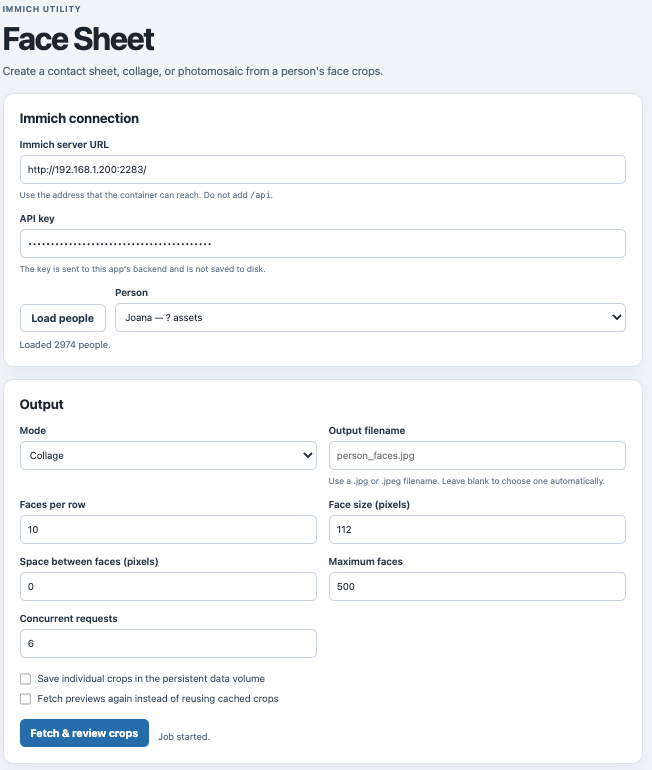
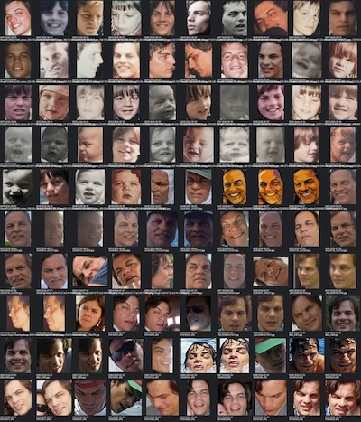
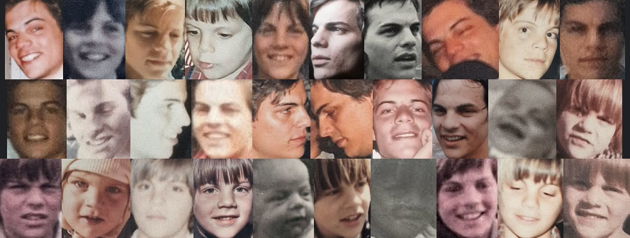
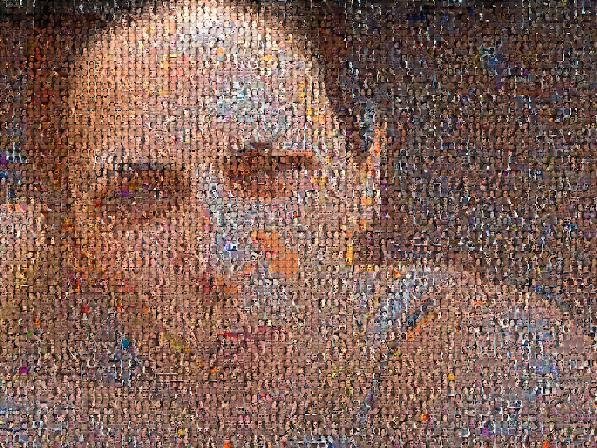

# [Immich](https://immich.app/) Face Sheet


This script finds an [Immich](https://immich.app/) person by name, retrieves the assets associated with that person, and crops the face rectangles [Immich](https://immich.app/) has identified. Choose one output mode: a contact sheet, a masonry collage, or a photomosaic made from a target image. It reads from [Immich](https://immich.app/) and does not change or upload any assets.

Use the **browser app** in Docker for interactive crop review and selection, or run `immich_face_sheet.py` directly from the **command line** to generate an output using the script's options.

If several people have similar names, the script lists the matches and asks you to choose one. Face crops are requested from [Immich](https://immich.app/)'s preview images, so the resulting faces may be lower resolution than the original photos.

## Requirements

- Python 3.10 or newer
- Network access to your [Immich](https://immich.app/) server
- An [Immich](https://immich.app/) API key with read access to the relevant people and assets
- The `requests` and `pillow` Python packages

Install the packages with:

```sh
python3 -m pip install requests pillow
```

## Get an [Immich](https://immich.app/) API key

In [Immich](https://immich.app/), open your user menu, go to **Account Settings**, and open **API Keys**. Create a key that can read people and assets. If the script reports `401` or `403`, check that the key is valid and has those read permissions. See [Immich](https://immich.app/)'s [user settings guide](https://docs.immich.app/features/user-settings/) for API key management.

The script accepts a key through the `IMMICH_API_KEY` environment variable or the `--api-key` option. The environment variable is recommended because command-line arguments can be saved in shell history.

In zsh, enter the key without displaying it or saving it in shell history:

```zsh
read -s "IMMICH_API_KEY?Paste your API key: "
echo
export IMMICH_API_KEY
```

Alternatively, pass `--api-key YOUR_KEY` to the script.

## Run the browser app with Docker

The browser app lets you choose a person and configure the same output options as the command-line tool. Its five numbered areas guide you through connecting to Immich, choosing the maximum face count and reviewing crops, setting output details, viewing the generated image, and browsing previous results. The image review lets you select or deselect individual crops, use **Select all shown** or **Deselect all**, sort by date oldest-first or newest-first, filter by file size and minimum resolution, and download all crops as a ZIP archive. The **Save individual crops** option is in step 2. All crops start selected, and crops hidden by filters are removed from the selection. A progress bar reports image fetching progress, and the generated output includes a download link. The app saves the last submitted options and person selection in a browser cookie so they can be restored on the next visit; the API key and uploaded photomosaic target are not saved. Previous results remain available across app restarts with file counts, storage usage, a download and delete action for each run, and a crop ZIP download when previews are available. **Delete all previous run data** removes stored run directories, including generated images, crop previews, and uploaded photomosaic targets, as well as saved crops and the reusable crop cache when no job is active. Active jobs and jobs awaiting crop selection are kept.

[](https://github.com/tiagonmas/immich-face-sheet/blob/main/assets/facesheet.png "facesheet.png")

From the project directory, start the container:

```sh
docker compose up --build
```

Open [http://localhost:8080](http://localhost:8080), enter the URL of your [Immich](https://immich.app/) server, and click **Load people**. Select a person, set **Maximum faces** in step 2, and click **Fetch & review images**. After the crops load, choose contact sheet, collage, or photomosaic and set the output options in step 3. Photomosaic mode also asks you to upload its target image. Click **Create output** to generate the result shown in step 4. You can change the step 3 options and create more outputs from the same crop review; each image is listed separately in previous results.

Enter an API key in the form, or set `IMMICH_API_KEY` in your shell before starting Docker Compose. You can set `IMMICH_BASE_URL` to prefill the server URL. For example:

```sh
export IMMICH_BASE_URL="http://<your-immich-server-ip>:2283"
read -s "IMMICH_API_KEY?Paste your API key: "
echo
export IMMICH_API_KEY
docker compose up --build
```

The API key entered in the form is sent to the container backend and is not saved to disk. Generated images, uploaded photomosaic targets, saved crops, and the reusable crop cache are stored in the `face-sheet-data` Docker volume. Docker Compose publishes the app on `localhost` only by default. Keep it on a trusted machine; add authentication and HTTPS before exposing it to other devices or the internet.

To stop the app, press **Ctrl+C** in the foreground terminal or run `docker compose down` in another terminal. The named volume remains so the crop cache is reused when you start it again.

## List people, birthdays, and featured photos

Run `list_immich_people.py` to write a Markdown table containing every Immich person, the saved birthday (if any), and a link to the person's featured thumbnail. The API key is used to list people; the photo links point to Immich's authenticated person-thumbnail endpoint.

```sh
python3 list_immich_people.py \
  --base-url "http://<your-immich-server-ip>:2283"
```

By default, the script writes `immich_people_birthdays.md` in the current directory. To create a CSV instead, pass `--format csv`; use `--output PATH` to choose another output file. The script reads from Immich and does not update people or photos.

## Run from the command line

From this directory, run:

```sh
python3 immich_face_sheet.py \
  --base-url "http://<your-immich-server-ip>:2283" \
  --person-name "John" \
  --output "john_faces.jpg"
```

Example output:



The output path is relative to the directory where you run the command, unless you provide an absolute path.
If that file already exists, the script asks whether to overwrite it. If you decline, it asks for a different filename; enter `q` to cancel.
Before making requests to [Immich](https://immich.app/), the script prints the effective run settings, including faces per row, face size, spacing, maximum faces, and whether metadata is included. It never prints the API key.
The script automatically caches face crops in `_crops/cache/` under your current working directory. Later runs for the same [Immich](https://immich.app/) server, person, asset, and face rectangle reuse those crops and skip downloading their preview images. The script still queries [Immich](https://immich.app/) for the person, assets, and face rectangles. The cache is created even when you do not pass `--save-crops`.
Pass `--force-fetch` to ignore cached crops for the current run, fetch fresh preview images from [Immich](https://immich.app/), and replace the cache entries. Use this if a cached crop is missing, damaged, or out of date. Pass `--save-crops` if you also want a numbered, easy-to-browse copy of the selected crops directly in `_crops/`; this is separate from the automatic cache.
Saved crop and cache filenames start with a lowercase, filesystem-safe version of the selected person's name. For example, crops use `tiago_0001.jpg`, and cache entries use `tiago_<hash>.jpg`. If a crop filename already exists, a number is added, such as `tiago_0001_2.jpg`. Existing hash-only cache files are renamed with the person's name when reused.
Numbered crops saved by older versions do not record which [Immich](https://immich.app/) asset and face they came from, so the script cannot safely match them to a person. The first run after upgrading may fetch those previews once to populate the new cache.
In collage mode, the script preserves each crop's proportions and uses the configured face size, faces per row, and spacing. In photomosaic mode, provide a target image with `--photomosaic-image PATH`; the script fills the target with square face tiles selected by average color. The target image is only read and is not modified. Set tile size with `--photomosaic-tile-size`. If you omit it, the script calculates the smallest size that keeps the target's tile count within the number of available face crops, then prompts you to accept it or enter another size. Smaller tiles create more detail and may repeat face crops.
Choose one output mode with `--mode`: `contact-sheet` (the default), `collage`, or `photomosaic`. Each run writes only the selected output to `--output`. A photomosaic also requires `--photomosaic-image PATH` for its target image. The script checks contact-sheet dimensions before downloading face previews and before writing. If the sheet would exceed Pillow's 65,500-pixel limit, it suggests settings calculated from the actual number of face crops, including the resulting dimensions.

To list all options, run either:

```sh
python3 immich_face_sheet.py --help
python3 immich_face_sheet.py help
```

## Which options affect each mode?

These options apply to all three modes: `--base-url`, `--person-name`, `--api-key` (or `IMMICH_API_KEY`), `--output`, `--max-faces`, `--workers`, `--save-crops`, and `--force-fetch`. The layout options depend on the selected mode:

| Mode | Options that affect the output |
| --- | --- |
| `contact-sheet` | `--faces-per-row`, `--face-size`, `--face-spacing`, and `--include-metadata` |
| `collage` | `--faces-per-row`, `--face-size`, and `--face-spacing`. The collage preserves each face crop's proportions. |
| `photomosaic` | `--photomosaic-tile-size`, `--face-spacing`, and the required `--photomosaic-image PATH`. The image is tiled with square face crops selected by average color. |

`--include-metadata` only applies to contact sheets. The script reports an error if you use it with collage or photomosaic mode. `--faces-per-row` and `--face-size` do not affect photomosaics because `--photomosaic-tile-size` sets its tile size and the target image determines the tile grid.

## Command-line options

| Option | Description | Default |
| --- | --- | --- |
| `--base-url URL` | [Immich](https://immich.app/) server URL, without `/api`. | Required |
| `--person-name NAME` | Person name to look up in [Immich](https://immich.app/). Similar matches trigger a selection prompt. Use `--person-id` to select directly. | One of name or ID |
| `--person-id ID` | Select a specific person by Immich ID, avoiding the similar-name prompt. | One of name or ID |
| `--api-key KEY` | [Immich](https://immich.app/) API key. `IMMICH_API_KEY` is used when this option is omitted. | Environment variable |
| `--mode TYPE` | Output type: `contact-sheet`, `collage`, or `photomosaic`. | `contact-sheet` |
| `--output PATH` | Output JPEG path for the selected mode. | `face-sheet.jpg`, `face-collage.jpg`, or `face-photomosaic.jpg`, based on mode |
| `--faces-per-row N` | Number of face crops on each row. `--columns` is an alias. | `10` |
| `--face-size PIXELS` | Width and height of each square face tile in contact-sheet or collage mode. `--tile-size` is an alias. | `112` |
| `--photomosaic-tile-size PIXELS` | Width and height of each square photomosaic tile. If omitted, calculate a minimum based on the number of face crops and prompt for a size. | Prompt |
| `--auto-photomosaic-tile-size` | Use the calculated minimum photomosaic tile size without prompting. | Off |
| `--include-metadata` | Show source filename and date below each face in contact-sheet mode. | Off |
| `--face-spacing N` | Pixel gap between face tiles. | `0` |
| `--save-crops` | Save each included face as a separate JPEG in `_crops/`. | Off |
| `--force-fetch` | Fetch fresh face previews instead of reusing cached crops, then update the cache. | Off |
| `--photomosaic-image PATH` | Target image; required with `--mode photomosaic`. | — |
| `--max-faces N` | Maximum number of face crops to include, taken in [Immich](https://immich.app/)'s search order. If omitted, include all matching faces. | All |
| `--workers N` | Number of concurrent requests to [Immich](https://immich.app/). | `6` |
| `-h`, `--help`, `help` | Show usage information. | — |

## Examples

These examples assume you have set `IMMICH_API_KEY` as described above. Each command looks up the selected person by name. If [Immich](https://immich.app/) returns several similar names, choose the correct person when prompted.

### Create a contact sheet with all faces

By default, the script includes every matching face, uses 10 faces per row, and adds no metadata or spacing:

```sh
python3 immich_face_sheet.py \
  --base-url "http://<your-immich-server-ip>:2283" \
  --person-name "John" \
  --output "john_faces.jpg"
```

### Fetch face previews again

Face crops are reused from `_crops/cache/` by default. Add `--force-fetch` to download the previews from [Immich](https://immich.app/) again and refresh the saved cache:

```sh
python3 immich_face_sheet.py \
  --base-url "http://<your-immich-server-ip>:2283" \
  --person-name "John" \
  --output "john_faces.jpg" \
  --force-fetch
```

### Make a smaller sheet with spacing

Limit the sheet to 300 faces and add a 10-pixel gap between tiles:

```sh
python3 immich_face_sheet.py \
  --base-url "http://<your-immich-server-ip>:2283" \
  --person-name "John" \
  --output "john_faces.jpg" \
  --max-faces 300 \
  --face-spacing 10
```

### Include filenames and dates, and save individual crops

Use larger face tiles, show the source filename and date below each face, and save each included crop in `_crops/`:

```sh
python3 immich_face_sheet.py \
  --base-url "http://<your-immich-server-ip>:2283" \
  --person-name "John" \
  --output "john_faces.jpg" \
  --face-size 180 \
  --include-metadata \
  --save-crops
```

### Create a collage

Select collage mode and write the result to `john_collage.jpg`:

```sh
python3 immich_face_sheet.py \
  --base-url "http://<your-immich-server-ip>:2283" \
  --person-name "John" \
  --mode collage \
  --output "john_collage.jpg"
```

Example output:



### Create a photomosaic

Select photomosaic mode and provide a target image to fill with face crops. If you omit `--photomosaic-tile-size`, the script shows the minimum calculated from the number of face crops and prompts you to choose a size:

```sh
python3 immich_face_sheet.py \
  --base-url "http://<your-immich-server-ip>:2283" \
  --person-name "John" \
  --mode photomosaic \
  --output "john_photomosaic.jpg" \
  --photomosaic-image "target.jpg"
```

Example output:



To set the tile size directly, add `--photomosaic-tile-size 24` to the command. Smaller values create more, smaller tiles and add detail; if the target has more tiles than available face crops, the script reuses some crops.
